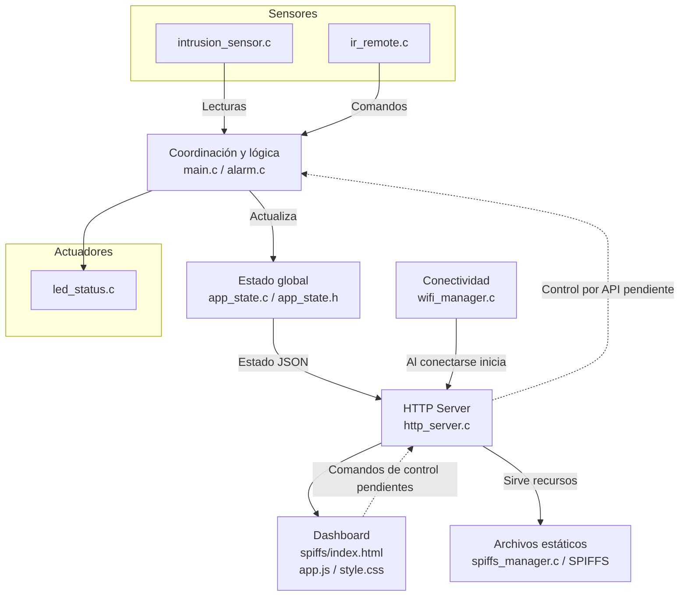

# ESP32 - Dashboard/panel de estado y servidor local

Firmware para ESP32 desarrollado con ESP-IDF. El proyecto integra una alarma
de intrusión, indicadores LED, control remoto infrarrojo y un servidor HTTP
local para consultar el estado del sistema.

## Arquitectura y modularización

El firmware se organizó por responsabilidades para que la lógica de la
aplicación no quede mezclada con los detalles de GPIO, Wi-Fi, almacenamiento o
HTTP. `main.c` coordina los módulos; cada módulo ofrece una interfaz pública
en su archivo `.h` y mantiene su implementación en el `.c` correspondiente.
Así es posible cambiar o ampliar una parte (por ejemplo, el sensor) sin
trasladar su implementación al bucle principal.



El flujo de consulta está implementado: `main.c` procesa las entradas y
mantiene el estado mediante `app_state`; el servidor HTTP lo expone al
dashboard. La interfaz actualiza los indicadores de Wi-Fi y alarma consultando
`GET /api/state` cada segundo. El flujo dashboard → actuadores sigue pendiente:
la API todavía no recibe comandos para controlar la alarma o los LEDs.

### Responsabilidades

| Módulo | Responsabilidad |
|---|---|
| `main.c` | Inicializa los módulos y coordina las entradas IR y del sensor con la alarma y sus LEDs. |
| `app_state` | Mantiene los datos compartidos de alarma, Wi-Fi y los campos previstos para sensores y actuadores. |
| `alarm` | Implementa las transiciones de estado de la alarma y su representación textual. |
| `ir_remote` | Captura cambios en GPIO 23, decodifica comandos NEC y los expone a la aplicación. |
| `intrusion_sensor` | Lee GPIO 36 y detecta el flanco configurado como intrusión. |
| `led_status` | Refleja los estados de alarma en los LEDs. |
| `wifi_manager` | Configura la conexión Wi-Fi STA y arranca el servidor cuando obtiene una IP. |
| `http_server` | Expone `GET /api/state` y atiende rutas de archivos estáticos desde SPIFFS. |
| `spiffs_manager` | Monta SPIFFS y consulta su capacidad y uso. |

En el flujo de control actual, `main.c` recibe los comandos IR y consulta el
sensor de intrusión; según esos eventos, coordina las transiciones de `alarm`
y actualiza `led_status`. `app_state` conserva el estado que consulta la API.
Cuando Wi-Fi obtiene una IP, `wifi_manager` inicia el servidor, que puede
responder con el estado JSON y servir los recursos presentes en SPIFFS.

## Avance actual

### Implementado

- Conexión Wi-Fi en modo estación (STA) y registro del estado de conexión.
- Máquina de estados de alarma: desactivada, activada y disparada.
- Control de alarma con el botón `2` de un control remoto IR NEC.
- Detección de flanco del sensor de intrusión mientras la alarma está activada.
- Indicadores LED según el estado de alarma:
  - Verde: desactivada.
  - Amarillo: activada.
  - Rojo: disparada.
- Montaje de SPIFFS.
- Servidor HTTP con `GET /api/state` para consultar el estado en JSON y una
  ruta para servir archivos estáticos desde SPIFFS.
- Dashboard estático en `spiffs/` integrado a la imagen SPIFFS durante la
  compilación (`index.html`, `app.js` y `style.css`).
- Tabla de particiones del proyecto con una partición SPIFFS de 1 MB.

### Pendiente de integrar o validar

- El dashboard muestra Wi-Fi y alarma. Las tarjetas de temperatura, humedad,
  iluminación, aire acondicionado y tomacorrientes están preparadas en la
  interfaz, pero sus valores aún no provienen de sensores o actuadores
  implementados.
- Agregar endpoints y lógica para controlar alarma y actuadores desde el
  dashboard.
- Implementar sensores de temperatura/humedad y control de iluminación,
  aire acondicionado y tomacorrientes. Esos campos aparecen en el JSON, pero
  todavía no tienen módulos que actualicen sus valores.
- Compilar y probar el firmware en una placa ESP32 y validar el hardware
  conectado.

## Hardware configurado

| Componente | GPIO |
|---|---:|
| Receptor IR | 23 |
| Sensor de intrusión | 36 |
| LED verde | 25 |
| LED rojo | 26 |
| LED amarillo | 27 |

Verifica el voltaje, el tipo de sensor y el cableado de tu placa antes de
conectar los componentes. El GPIO 36 es solo de entrada y no tiene resistencias
internas pull-up/pull-down.

## Configuración

1. Instala ESP-IDF y abre una terminal con su entorno configurado.
2. Configura `WIFI_SSID` y `WIFI_PASSWORD` en `main/wifi_manager.c` con los
   datos de tu red. No guardes credenciales reales en el repositorio.
3. En `idf.py menuconfig`, selecciona **Partition Table → Custom partition
   table CSV** y establece `partitions.csv` como archivo. La configuración
   `sdkconfig` local está ignorada por Git, así que cada entorno debe verificar
   este ajuste. La tabla define una partición SPIFFS de 1 MB.

## Compilar y flashear

Desde la raíz del proyecto, en la terminal de ESP-IDF:

```shell
idf.py set-target esp32
idf.py build
idf.py -p <PUERTO> flash monitor
```

Reemplaza `<PUERTO>` por el puerto serie de la placa. La compilación genera la
imagen SPIFFS y `FLASH_IN_PROJECT` hace que se incluya al flashear. Cuando el
ESP32 se conecte a Wi-Fi, el monitor serial mostrará la dirección IP. Desde un
dispositivo en la misma red se puede abrir el dashboard:

```text
http://<IP-DEL-ESP32>/
```

El endpoint JSON está disponible en:

```text
http://<IP-DEL-ESP32>/api/state
```
